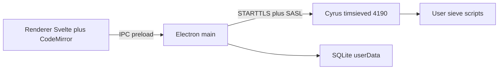

# Sieve Editor

Desktop editor for **Cyrus Sieve** scripts on a ManageSieve-compatible server. The point is to list, edit, save, activate, and delete scripts against live ManageSieve — with syntax highlighting — without standing up a web server or copying the old AGPL app.

- Protocol: [RFC 5804](https://datatracker.ietf.org/doc/html/rfc5804) (ManageSieve)
- Language: [RFC 5228](https://datatracker.ietf.org/doc/html/rfc5228) (Sieve)
- Sibling tree `sieve-old` (thsmi/sieve) is a **protocol and UX reference only**. Do not copy that code.

This is **not** SvelteKit. Browsers cannot speak ManageSieve (raw TCP). Electron’s **main process** owns the socket.

## Architecture



| Piece | Where |
| --- | --- |
| Window, IPC, session | [`src/main/index.ts`](src/main/index.ts) |
| ManageSieve client | [`src/main/managesieve.ts`](src/main/managesieve.ts) |
| SQLite / accounts | [`src/main/db/`](src/main/db/) |
| Preload `contextBridge` | [`src/preload/index.ts`](src/preload/index.ts) |
| Login, list, editor | [`src/renderer/src/App.svelte`](src/renderer/src/App.svelte) |

Main uses `contextIsolation: true` and `nodeIntegration: false`. The renderer never gets `net` / `tls`. One TCP session per logged-in account. IPC: `list`, `get`, `put`, `activate`, `delete`, `check`.

Cyrus allows **one active script**. Syntax errors come back as `NO "line N: …"`. Script bodies use ManageSieve literals (`{n+}` / `{n}`).

Host and port are editable (default port **4190**, Cyrus `timsieved`). SASL **PLAIN** and **LOGIN**. STARTTLS when the server offers it. TLS verification uses the OS trust store, not Node’s Mozilla bundle; login can skip verify or allow plaintext as a fallback.

## Local data

No MySQL. Drizzle ORM + **better-sqlite3** in main only.

- File: `sieve.sqlite` under Electron `app.getPath('userData')` (not in this repo)
- Tables: `accounts` (host, port, user, TLS prefs, last script — one row per server+user), `settings` (window bounds, last account, indent)
- Passwords: `safeStorage.encryptString` (Windows DPAPI), ciphertext in SQLite — never plaintext, never committed
- Migrations: [`drizzle/`](drizzle/) — applied on startup

Scripts stay on Cyrus. SQLite is not a backup of script bodies.

## Dev / package

Electron 43+ does **not** download its binary in npm `postinstall`. This repo’s `postinstall` runs `node ./node_modules/electron/install.js` then rebuilds native modules. If you see `Error: Electron uninstall`, the zip was not extracted — run that install script again.

```bash
cd sieve-editor
pnpm.cmd install
pnpm.cmd dev
```

Windows installer:

```bash
pnpm.cmd run build:win
```

Unpackaged dir only: `pnpm.cmd run build:unpack`. Linux locally: `pnpm.cmd run build:linux` (AppImage + .deb).

## Release

Ship from a clean `develop` that matches `origin/develop`. `main` is the release branch.

```bash
pnpm release
pnpm release:patch
pnpm release:minor
pnpm release:major
pnpm release:patch -- beta
pnpm release -- beta
pnpm release -- rc
```

`pnpm release:patch`, `release:minor`, and `release:major` move the version numbers. With `beta` or `rc`, that new version starts at `vX.Y.Z-beta.1` or `vX.Y.Z-rc.1`. Repeating `pnpm release -- beta` (or `rc`) on that same version increments the number (`beta.2`, `rc.2`). `pnpm release` with no channel then tags the stable `vX.Y.Z`. The script merges `develop` into `main`. That merge commit is `Release vX.Y.Z`, and its message lists the changes since the previous release. It then fast-forwards `develop` to that commit and pushes the tag. GitHub Actions publishes the GitHub Release with Windows (NSIS setup and portable) and Linux (AppImage and .deb) binaries, then writes notes from commits since the previous tag. Stable notes skip prerelease tags. `beta` and `rc` tags are GitHub prereleases. Settings chooses which of those the update check includes: beta includes rc and stable, rc includes stable, and Off skips the check. Do not create that GitHub Release locally. On the stable choice, a packaged beta is offered the stable release when it exists.

| Platform | Installer | Portable |
| --- | --- | --- |
| Windows | NSIS `sieve-editor-*-setup.exe` | `sieve-editor-*-portable.exe` |
| Linux | `.deb` | AppImage |

Linux artifacts are built on Ubuntu runners; they are not tested on a local Linux desktop. macOS is not in this flow (no signing/notarization). `gh` must be logged in (`gh auth login -p ssh`).

Packaged builds check GitHub Releases on startup (and when you click the version next to the app name). **Settings** chooses the channel: Stable (published releases), Release candidate (rc and stable), Beta (beta, rc, and stable), or Off. A stable release of the same version is newer than its beta or rc. If a newer release on that channel exists, the app asks whether to update, then a **download location** dialog (first time: setup defaults to Downloads, portable to the folder you launched from; after that, the last chosen folder). **NSIS** then offers to run the installer; **portable** / **AppImage** offer to restart into the new file and leave the old exe in place; **.deb** opens the GitHub download page. Draft or empty GitHub Releases are invisible to the updater. Builds are unsigned, so Windows may still warn on SmartScreen.

The Windows setup wizard asks where to install (not one-click). Shortcut and window title are **Sieve Editor**, with the version next to the name.

UI notes:

- Script list: **include tree** from the active script (RFC 6609); unused scripts below
- CodeMirror 6 + `@codemirror/legacy-modes` sieve mode; keywords from CAPABILITY `SIEVE`
- Debounced syntax check (~500ms). A local Sieve grammar check (commands, tests, `require`, tags, and arguments for RFC 5228 and the extensions Cyrus accepts) runs immediately. When connected, `CHECKSCRIPT` (or PUTSCRIPT/DELETESCRIPT if the server has no CHECKSCRIPT) is merged in after the pause.
- Multiple servers/accounts: saved list on connect; **Disconnect** returns there. Socket drop stays in the editor with **Connect**.
- Save limit **50K** (`sieve_maxscriptsize`)
- Editor **tabs** above the buffer: open several scripts at once (tree click, New, Duplicate, Import). Unsaved tabs show a dot; × or middle-click closes with **Save** / **Discard**. Switching tabs keeps each buffer. Named tabs are restored on the next connect.
- Script lifecycle: **Save** stays on the toolbar (**Ctrl+S** / **Cmd+S**). **Actions** menu: new, format (re-indent with the configured tab/spaces), duplicate, rename, activate (confirms; refuses syntax errors; unsaved buffers must be saved first), delete, export/import `.sieve` files. Import opens a new tab until Save. Rename is put + optional setactive + delete.

## Out of scope

Graphical block editor, GSSAPI/Kerberos, a browser-facing HTTP proxy, copying sieve-old, macOS packages.

## Plans

Original implementation notes live in [`docs/plans/`](docs/plans/). Start with this README for how the app works now.
